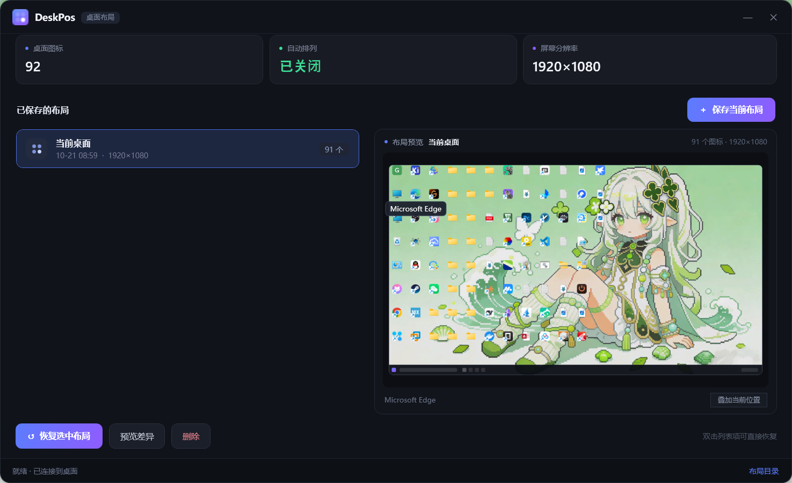
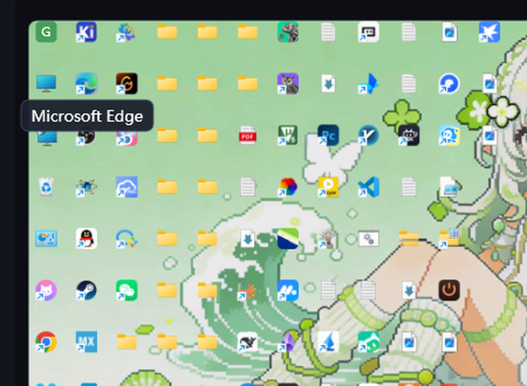

# DeskPos · 桌面布局

记住 Windows 桌面图标的位置，随时一键恢复。带**真实缩略预览**（真实壁纸 + 真实图标 + 任务栏），点开就能看到桌面以前的样子。

> 当前版本 **v0.0.1**（初版）



## 它解决什么问题

换分辨率、改缩放、插拔副屏、装完显卡驱动、explorer 崩溃重启……桌面图标就全乱了。DeskPos 把每个图标的名字和坐标存成一份 JSON，需要的时候精确还原，坐标是**像素级**的，不是重新排队。

## 功能

- **保存 / 恢复**：记录每个图标的名称与坐标，恢复时按名字匹配，不会因为顺序变化而错位
- **真实预览**：右侧画出缩小的桌面——用你当前的壁纸做背景、逐个图标取系统真实图标、按保存时的坐标摆好，连任务栏都画上
- **悬停看名字**：图标太小认不出时，鼠标停上去就弹出名称
- **叠加当前位置**：蓝色虚线标出「这次恢复会移动的那几个图标现在在哪」，恢复前心里有数
- **差异预览**：只报告"几个会动 / 几个已消失 / 几个是新增"，不动桌面
- **自动处理干扰项**：恢复前自动关掉「自动排列图标」，支持 125%/150% 缩放与主屏左侧的负坐标副屏



## 两种形态，共用一套布局文件

| | GUI（C# / WPF） | CLI（Python） |
|---|---|---|
| 体积 | 单文件 exe ≈ 300 KB | 单文件脚本 ≈ 17 KB |
| 依赖 | .NET 10 Desktop Runtime | 纯标准库，零依赖 |
| 常驻内存 | 关闭即释放 | 不运行时完全不占 |
| 适合 | 日常点点点 | 任务计划、批处理、开机自动恢复 |

两者读写同一份布局：`%APPDATA%\DesktopIconPos\layouts\*.json`，CLI 存的布局 GUI 里能直接预览，反过来也一样。

### GUI 用法

下载 [Releases](https://github.com/PandaGuGu/DeskPos/releases) 里的 `DeskPos.exe`，双击运行。选布局 → 右侧立刻预览 → 「恢复选中布局」（或双击列表项）。

### CLI 用法

```bash
python deskpos.py save 工作          # 保存当前桌面
python deskpos.py restore 工作       # 恢复
python deskpos.py diff 工作          # 只看差异，不修改桌面
python deskpos.py status             # 图标数 / 是否开着自动排列
python deskpos.py list               # 列出所有布局
python deskpos.py show 工作          # 查看某个布局的内容
python deskpos.py delete 工作
python deskpos.py restore 工作 --dry-run   # 演练，不写入
```

开机自动恢复（无需常驻进程）：任务计划程序 → 登录时 → `python deskpos.py restore 工作`。

## 布局文件格式

```json
{
  "name": "工作",
  "created": "2026-10-21 08:59:00",
  "screen": { "w": 1920, "h": 1080 },
  "auto_arrange": false,
  "icons": [
    { "name": "此电脑", "x": 17, "y": 124 },
    { "name": "Microsoft Edge", "x": 112, "y": 124 }
  ]
}
```

纯文本，可以手动编辑、对比、备份。

## 构建

```bash
cd src/DeskPosUI
dotnet publish -c Release -r win-x64 --self-contained false \
  -p:PublishSingleFile=true -p:IncludeNativeLibrariesForSelfExtract=true -o ../../dist
```

想要换台电脑也能直接跑（体积约 90 MB）：把 `--self-contained false` 换成 `--self-contained true`。

生成图标（纯标准库，4× 超采样 + 圆角矩形 SDF + 蓝紫渐变）：

```bash
python tools/make_icon.py
```

## 实现要点

- 读写位置靠 `LVM_GETITEMPOSITION` / `LVM_SETITEMPOSITION32` 加 `ReadProcessMemory` / `WriteProcessMemory`
  - 必须用 `LVM_SETITEMPOSITION32` 配远程 `POINT`；老式的 `LVM_SETITEMPOSITION` 会把坐标压进 16 位，副屏在主屏左侧时负坐标直接错位
- 必须先 `SetProcessDpiAwarenessContext(-4)`，否则 125% 缩放下读到的是逻辑像素，恢复后会整体偏移
- 恢复前清掉 `LVS_AUTOARRANGE` 样式，否则 `LVM_ARRANGE` 会立刻把图标重新排队
- 预览里的图标：`SHGetFileInfo` 取 32px 图标；「此电脑」「回收站」「网络」「控制面板」这类虚拟项要先 `SHParseDisplayName` 拿 PIDL，再配 `SHGFI_PIDL` 取图标
- 布局里存的是**显示名**，快捷方式真实文件名带 `.lnk`，所以还维护了一份「短名 → 完整路径」索引（含 `C:\Users\Public\Desktop`），否则一半图标取不到
- 壁纸用 `SystemParametersInfo(SPI_GETDESKWALLPAPER)` 读取当前壁纸路径

## 已知限制

- 图标按**文件名**匹配：改名或删掉的文件不会被恢复，新加的图标保持原位
- 要跨进程读写 explorer 内存，**杀软报毒是常态**，加白名单即可
- Win10 1809 之后 shell 自己也缓存了一份位置，通过内存改写的位置在 explorer 重启后可能需要再恢复一次
- 预览背景只是静态壁纸；如果用的是 Lively Wallpaper 这类动态壁纸，取到的是它当前的截图帧

## License

[MIT](LICENSE)
